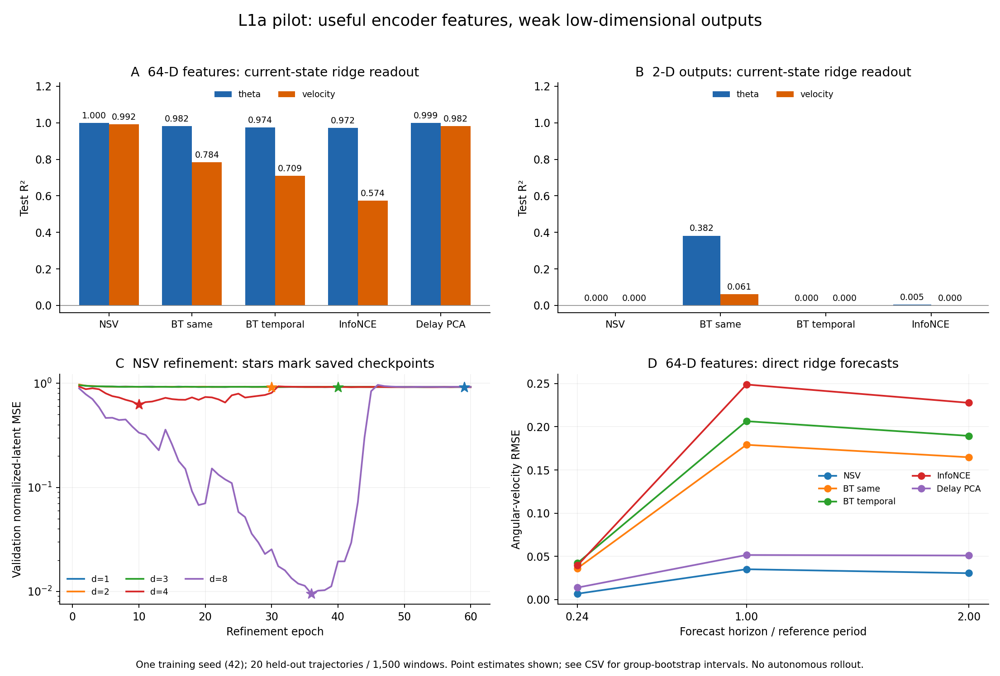

# L1a 首轮结果：编码器保留了状态，低维压缩尚未通过验证

目前最明确的结果是：**NSV 的 64 维预测编码 h 能很好地恢复角度和角速度，ID 也接近 2；但本次 2 维 refiner 没有学到可用的状态表示。** InfoNCE、BT-temporal 和 BT-same 的 h 也保留了不同程度的状态信息，而它们的 2 维投影 z 明显较弱。这批数据支持定位问题，尚不足以宣布整个 NSV/SSL/Barlow 方法验证成功或失败。

**Material Passport**

- Origin Skill: academic-research-suite / experiment-agent
- Origin Mode: validate
- Origin Date: 2026-10-28
- Verification Status: ANALYZED
- Version Label: l1a_validation_v1
- Source: 用户提供的 `pendulum_results_173b0c7eaac813d1.zip`
- Overall Confidence: CAUTION；所列数值可在报告中核对，机制解释及跨 seed 推广仍待验证。

**这次实际跑了什么**

| 项目 | 本次配置 |
|---|---|
| 数据集 / 分析 ID | `173b0c7eaac813d1` / `a70d291efb9ff88c` |
| 学习与评估条件 | 只有 L1a：固定 L=1，观测噪声为 0 |
| 训练视图增强 | 额外 Gaussian noise std=0.01；因此训练输入并非完全无噪声 |
| 动力学 | g=1，damping=0.02，100 条轨迹，每条 8 个参考周期、401 帧 |
| 数据划分 | 匹配源码和配置推得 60/20/20 条 train/val/test 轨迹；CSV 确认 test=20 组 |
| 共同输入 | 5 帧历史；时间配对 lag=5 帧，即 0.1 T0，窗口不重叠 |
| 方法 | NSV、InfoNCE、BT-temporal、BT-same，各一个训练 seed=42 |
| 训练预算 | 第一阶段各 30 epochs；NSV refiner 各维数 60 epochs |
| 输出维数 | h=64；InfoNCE/BT z=2；NSV d=1/2/3/4/8 |
| 评估 | 1,500 个窗口，来自 20 条完整保留轨迹；300 次轨迹 bootstrap |

39 也生成了变摆长数据和 oracle ID，但包中没有 L1b/L1c 的学习结果。不能把这些 oracle 检查理解为已经验证了噪声鲁棒性或摆长恢复。

归档共 34 个文件。原始 CSV 的 SHA256 与 `complete.json` 一致；四个 run 的元数据引用一致；本地 `l1_data.py`、`l1_learning.py`、`l1_evaluation.py` 哈希与运行记录一致。完整文件校验清单见 [provenance.json](provenance.json)。ZIP 不包含原始状态数组、features 或模型权重，因此这里没有独立重算 probes、bootstrap 或训练；代码/文件一致性检查不等于完整实验复现。

**1. 先看相同的 64 维表示，而不是只看原图**

下表是当前状态的 held-out R²。Ridge 与固定 64 隐藏单元的 MLP 分别评估线性和一种有限容量的非线性读出。它们使用物理标签做事后评估；表征训练不使用这些标签。

| 表示（均 64 维） | Ridge θ R² | Ridge v R² | MLP θ R² | MLP v R² |
|---|---:|---:|---:|---:|
| NSV h | 0.9996 | 0.9923 | 0.9987 | 0.9976 |
| BT-same h | 0.9824 | 0.7837 | 0.9963 | 0.9697 |
| BT-temporal h | 0.9740 | 0.7087 | 0.9911 | 0.9267 |
| InfoNCE h | 0.9715 | 0.5741 | 0.9637 | 0.4066 |
| Delay-PCA | 0.9989 | 0.9821 | 0.9948 | 0.9935 |

NSV h 的当前 θ RMSE=0.00802，轨迹 bootstrap 95% 区间为 [0.00588, 0.01001]；v RMSE=0.03482，区间为 [0.02546, 0.04335]。这支持“本次预测编码含有易读出的物理状态”。PCA 也已经很强，说明这套历史图像本身提供了充分的可恢复信息。

BT 两种 h 的速度读出在 MLP 下改善明显，说明线性 probe 会低估其中可读出的信息。InfoNCE h 的 MLP 反而更差，且达到迭代上限；不能据此说换非线性读出必然改善。共 14 个 MLP fits 中有 5 个记录了 convergence warning，其中包括 BT 两种 h、InfoNCE h，以及 BT-same/InfoNCE z。

这里没有随机未训练 CNN 基线，因此尚不能量化“训练相对于随机特征增加了多少信息”。PCA 的 64 个成分来自降采样图像窗口，不能当成与 CNN 完全相同的特征构建过程。

**2. 低维投影结果解释了原图为什么看起来不好**

| 低维表示 | 维数 | Ridge θ R² | Ridge v R² | MLP θ R² | MLP v R² |
|---|---:|---:|---:|---:|---:|
| NSV z_d2 | 2 | 0.00004 | 0.00004 | −0.00034 | −0.00050 |
| BT-same z | 2 | 0.3821 | 0.0613 | 0.4543 | 0.1147 |
| BT-temporal z | 2 | 0.00004 | 0.00001 | 0.00004 | −0.00019 |
| InfoNCE z | 2 | 0.0050 | 0.00003 | 0.2784 | 0.0247 |
| InfoNCE z_unit | 2 个坐标 | −0.00001 | 0.00021 | 0.00011 | 0.00044 |
| NSV z_d4 | 4 | 0.6172 | 0.1149 | 0.6374 | 0.1239 |
| NSV z_d8 | 8 | 0.7461 | 0.8909 | 0.9877 | 0.9761 |

R²≈0 表示这些读出器的性能接近以测试目标均值作常数预测的参照水平。线性读出失败并不证明没有信息；本次有限 MLP 也失败时，只能说尚未恢复出稳定可用的状态坐标。

原 `latent_test.png`、`state_readout_test.png` 和 `forecast_test.png` 对每个方法固定选择第一个可用低维表示，所以 NSV 展示的是 z_d2，**没有展示 NSV h 的强结果**。同时图里的 PCA 预测使用全部 64 个成分，不是散点图显示的两个 PC；将它与 2 维 z 直接理解为等容量的总体方法排名会误导。新诊断图把 64 维 h 与 2 维 z 分开。

InfoNCE 的 loss 会将 z 归一化：2 个坐标的非零向量归一化后位于圆周，只剩一个连续自由度。它不能作为覆盖整个二维状态区域的连续一一坐标。z_unit 的估计 ID 为 0.92–0.99，与这个约束相符；但它的 θ/v 读出也很差，所以现在不能声称它已经成功学习了“相位”。增大 projector 输出维数是一个结构诊断，原始 z 的模长也没有直接受到 cosine loss 的约束。

BT-temporal 的低 loss 与状态读出差同时出现。它可能偏向配对窗口间变化较慢的量，例如能量/振幅，也可能存在折叠、对称性丢失或优化问题；现有报告不能区分这些解释。BT-same 有非零但有限的状态信息，说明并非只改成同一时刻配对就自动解决二维压缩。两种 z 都有可见变化和非零有效维数，不能仅凭 R²≈0 叫作“常数坍塌”。原始 Barlow 工作的评估协议及高维输出设置也不同，当前 2 维 stress test 不构成对整个算法的否定。[Barlow Twins 原论文](https://proceedings.mlr.press/v139/zbontar21a.html)

**3. NSV 的 ID 诊断接近 2，但 refiner 仍未通过**

下表统一使用 nb42 `id_train.json` 的中位数，k 为邻居数。nb40 的独立 ID 文件使用另一抽样 seed，数值会略有不同。

| 对象 | k=10 | k=20 | k=40 |
|---|---:|---:|---:|
| 真实 (θ,v)，nb39 oracle | 1.744 | 1.891 | 2.000 |
| NSV h | 1.833 | 1.898 | 1.961 |
| InfoNCE h | 1.938 | 1.999 | 2.000 |
| BT-same h | 2.033 | 2.156 | 2.123 |
| BT-temporal h | 2.153 | 2.204 | 2.167 |
| Delay-PCA | 1.841 | 1.960 | 2.030 |
| NSV z_d2 | 1.848 | 1.919 | 1.979 |

NSV z_d2 的 ID 同样接近 2，却几乎读不出 θ/v。**ID≈2 不是“找到了两条物理状态变量”的充分条件**，还要检查可恢复性、预测能力与局部几何。Oracle 的状态采样范围/stride 与模型评估窗口不同，表格用于量级参照，并非严格配对的 ID 偏差检验。变摆长 oracle 的 median ID=2.68–2.72、mean ID=2.77–2.94，也提醒我们估计值受尺度和分布影响，不能要求精确等于整数。

| NSV refiner 维数 | 最佳验证 normalized-latent MSE | 最佳 epoch | 最后一轮验证 MSE |
|---|---:|---:|---:|
| 1 | 0.91790 | 59 | 0.92040 |
| 2 | 0.91819 | 30 | 0.92012 |
| 3 | 0.91813 | 40 | 0.92098 |
| 4 | 0.62298 | 10 | 0.91904 |
| 8 | 0.00951 | 36 | 0.92090 |

d=1/2/3 的训练 MSE 最终约为 1；对标准化目标，这是接近只输出零/均值的尺度，不能当作成功重建。d=8 曾经重建得很好，44–46 epoch 左右明显恶化；d=4 也在中途退化。这是本次优化不稳定的直接证据，不能据此推断摆的物理状态需要 8 维。

源码在导出特征前恢复最佳验证 checkpoint，并用 `clone()` 复制保存状态，所以不能用“最终导出了最后一轮坏权重”解释这里的结果。该行为只做了代码与日志核对；缺少实际权重，尚未重新载入验证。

当前由我实现的 refiner 是一个适配版本，并非 Chen 官方配置的逐项复现。官方单摆网络为 64→128→64→32→2→32→64→128→64，瓶颈使用 sine，内部 decoder 入口沿用 SIREN 内层初始化，最终线性层也有 SIREN 初始化；本地版本使用较浅的线性瓶颈、decoder `first=True` 和默认线性输出初始化。两者的优化表现不能直接等同。[Chen 官方 model_utils.py](https://github.com/BoyuanChen/neural-state-variables/blob/main/model_utils.py)

本地 refinement 复用 lr=1e-3，未设置学习率衰减或梯度裁剪。官方训练类提供 lr=1e-4 默认值及 MultiStepLR，SIREN 官方图像拟合示例也用 1e-4。它们为调试提供参照，但并不证明本任务只要改学习率就会成功。[Chen 训练代码](https://github.com/BoyuanChen/neural-state-variables/blob/main/models.py)，[SIREN 示例](https://github.com/vsitzmann/siren/blob/master/experiment_scripts/train_img.py)

**4. 预测能力：h 有用，但当前评估是直接读出**

以下为 h/PCA 64 维表示经过 ridge 得到的未来状态 RMSE，每格为 θ / v；不是从低维状态自主积分的 rollout。

| 表示 | 0.24 T0 | 1 T0 | 2 T0 |
|---|---:|---:|---:|
| NSV h | 0.03775 / 0.00675 | 0.01539 / 0.03510 | 0.02821 / 0.03053 |
| BT-same h | 0.19477 / 0.03613 | 0.03885 / 0.17913 | 0.06882 / 0.16472 |
| BT-temporal h | 0.22491 / 0.04218 | 0.03882 / 0.20646 | 0.06368 / 0.18948 |
| InfoNCE h | 0.27130 / 0.03943 | 0.03753 / 0.24891 | 0.07395 / 0.22772 |
| Delay-PCA | 0.05686 / 0.01385 | 0.03578 / 0.05159 | 0.06293 / 0.05097 |
| Oracle-state persistence | 0.54104 / 0.51736 | 0.08842 / 0.08389 | 0.15947 / 0.15316 |

在这一个 seed 上，NSV h 六个预测 RMSE 点估计都小于 PCA；2T0 的角度/速度误差分别低约 55.2% / 40.1%。对应 95% 区间：NSV θ [0.01829,0.03735]、PCA θ [0.04706,0.07973]；NSV v [0.02221,0.03775]、PCA v [0.01744,0.07918]。这些是各自误差的区间，不是方法差值的配对区间；不据此报告跨 seed 显著优越。

预测误差不必随 horizon 单调增长。这个振子在约一整周期后接近原相位；近四分之一周期的角度和速度作用近似交换。因此某方法在 0.24T0 预测 v 很好，并不单独证明它掌握了完整状态。Persistence 同样因近周期性在 1T0 好于四分之一周期；其输入还是真实当前状态，不是无标签图像。

**5. 第一阶段训练及评估边界**

| 方法 | 最佳验证 epoch | 最佳验证 loss | 最后一轮训练 / 验证 loss |
|---|---:|---:|---:|
| NSV | 29 | 0.00009055 | 0.00010019 / 0.00009406 |
| InfoNCE | 12 | 3.92978 | 2.83645 / 3.94966 |
| BT-temporal | 28 | 0.00957249 | 0.00003783 / 0.00977758 |
| BT-same | 6 | 0.00014836 | 0.00000155 / 0.00055260 |

各方法 loss 的定义和尺度不同，不能横向排名。对于 InfoNCE/BT，训练随机打乱 windows，而验证按轨迹/时间顺序组 batch。根据匹配源码和配置，每条轨迹有 196 个训练/验证窗口，验证每个 batch 只有 1–2 条轨迹，`drop_last=True` 还丢掉最后 80 个窗口。Contrastive negatives 和 Barlow batch correlation 对 batch 组成敏感，所以 train–val gap 混合了采样协议变化，不能全部解释为过拟合。后续可使用固定种子的跨轨迹混合验证 batch，所有方法使用明确且稳定的验证协议。

本次模拟的 step-halving 最大误差约 1.2e-8，保存的能量增量最大值为负，支持数值积分自检正常。未发现当前报告中的数据行数/配置交叉引用矛盾，但原始数组缺失，无法独立检查每行特征与真值的对应或重算误差。

只有 20 个独立测试轨迹，而不是 1,500 个独立实验。Bootstrap 区间仅反映固定训练模型下的测试轨迹变动，不包含训练 seed、重新采样数据集或调参的不确定性。多个维数、目标和 horizons 共 146 行是探索性比较，没有做显著性检验；没有 p 值可校正，也不能通过挑选最漂亮的一行形成确认性结论。

**6. 下一轮优先级**

1. 先保留当前结果，继续解决 L1a 的低维表示问题，再解释 L1b/L1c 的差异。已有 NSV h 可以用于 refiner 调试，无需为了每个 refiner 设置重新训练图像 encoder；现有入口尚没有独立的 refinement-only 流程，需要实现后才能这样运行。
2. 为 NSV 增加单独的 refinement 学习率与训练配置，核对 SIREN 层和初始化，加入一个简单平滑 MLP autoencoder 作为优化对照。先用 train/val 比较 d=2 的稳定重建和 checkpoint 行为，再固定设置评估。不要把 d=8 选成“物理维数答案”。
3. 对 InfoNCE/BT，分别报告 h 与 z，并在相同设置下比较 projector dim=2/8/16；保持二维结果作为瓶颈压力测试。InfoNCE normalized z 的坐标数与自由度要分清。若做维数匹配基线，可再加入 PCA-2/3/8，而不是只对比 PCA-64。
4. 增加能量/振幅读出、时间轨迹连续性、近邻状态歧义和更稳健的 train/val 非线性读出诊断，用来检验“学到慢量”或“坐标折叠”的假说。先检查训练/验证，避免反复用本次 test 调参。
5. 验证协议固定后补至少几个训练 seeds，并尽可能留出新的模拟轨迹集作为确认性测试；多 seed 仍不能替代噪声和摆长实验。

进一步诊断现有表示只需补交四个 run 的 `features.npz` 和本次分析目录的 `evaluation_truth.npz`。它们能支持逐轨迹检查及当前状态的额外读出；若要重算未来 horizons 的配对误差区间，还需要 `datasets/173b0c7eaac813d1/fixed.npz`，或可核对的逐样本未来预测与真值。若要核对 checkpoint 的实际载入/重建行为，则再需要 `model_best.pt` 与 NSV 的 `refiner_d*.pt`。这些文件不是完成本报告的前提。

**Fallacy scan：11/11 已检查适用性**

| 项目 | 本次判断 |
|---|---|
| Simpson's paradox | 仅一个条件/seed；缺少逐轨迹误差，不能检验子组反转；不把汇总结果推广到每条轨迹。 |
| Ecological fallacy | 明确区分窗口与独立轨迹；bootstrap 单位为轨迹。 |
| Berkson's paradox | 完整 run 的筛选可能造成选择性；包中无全部尝试清单，不能排除。 |
| Collider bias | 当前是表示比较，无显式因果调整模型；不作机制因果断言。 |
| Base rate neglect | 非分类任务，不适用；当前 R² 和 persistence 参照已说明。 |
| Regression to the mean | 不从最好维数/epoch 的测试结果推断再训练必然改善；训练 checkpoint 用验证 loss。 |
| Survivorship bias | 只分析四个完成 run；未知是否存在未导出的失败尝试。 |
| Look-elsewhere effect | 保留全部 146 行，表中明确 layer/dimension/probe；不选择最佳 test seed。 |
| Garden of forking paths | 首轮探索；后续设置基于 train/val，并建议新测试轨迹确认。 |
| Correlation versus causation | 读出能力不等于模型识别了真实机制；能量解释属于待检验假说。 |
| Reverse causality | 未来标签索引由源码定义；不把预测读出当作因果方向识别。 |

**可复核的产物**

- [全部当前状态指标](current_state_all.csv)、[全部预测指标](forecasts_all.csv)、[ID 汇总](id_summary.csv)。
- [第一阶段训练汇总](training_summary.csv)、[NSV refinement 汇总](refinement_summary.csv)。
- [诊断图 PNG](l1a_diagnostics.png)、[诊断图 PDF](l1a_diagnostics.pdf)。
- [只读取已有结果的汇总脚本](summarize_received.py)，以及 `received/` 内按原路径保留的报告。
- Reproducibility verdict: CANNOT_VERIFY full rerun；元数据、CSV checksum 和源码 provenance 检查通过。未重新训练、未重算 probes、未修改实验实现。

miao
