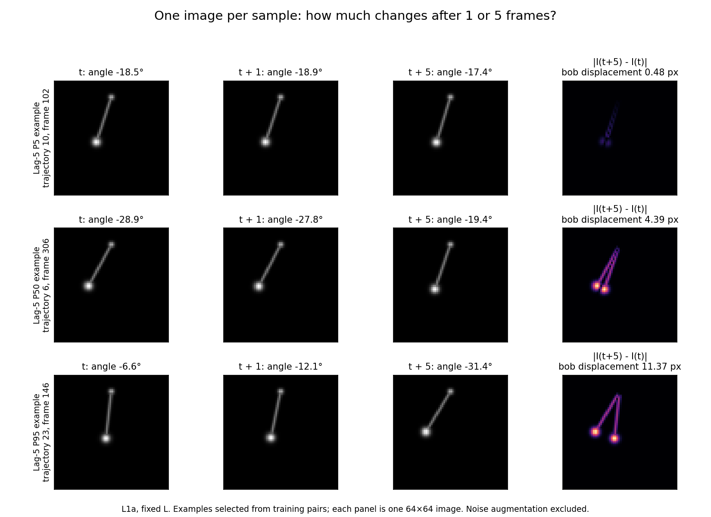

# 单帧输入与相隔 5 帧的变化量（2026-11-04）

用户决定后续默认每帧一个 sample，不拼接连续图像。已将 TrainConfig、Encoder、EvalConfig 和生成的 notebooks 39–42 同步到 window=1；配对 lag 仍为5。输入张量为 `[batch,1,64,64]`，temporal pair 为 `(I_t,I_{t+5})`。原始五帧实验属于独立历史协议。

**5帧相隔多久？**

模拟无量纲 g=L=1，因此参考周期 T0=2π，每周期50个采样间隔。单帧间隔为0.125664，5帧为0.628319，即0.1T0。这里的 frame 不是 calendar day。

小振幅谐振近似下，相隔5帧的循环相位推进36°；这不是摆杆角度 θ 必须变化36°。实际摆角变化依赖振幅和当前相位，转折附近可以很小，快速通过最低点时可以较大。

**按原始参数与 seed 重新模拟得到的量级**

统计仅用60条训练轨迹，每条相同的198个 anchor：t=0,2,…,394，共11,880对；lag1和lag5使用相同 anchor。渲染与原代码一样先量化到uint8，再转为[0,1]，未加训练视图噪声。

| 指标 | 相隔1帧 | 相隔5帧 |
|---|---:|---:|
| 参考周期比例 | 0.02T0 | 0.10T0 |
| 小振幅参考相位推进 | 7.2° | 36° |
| 绝对摆角变化：平均 | 2.20° | 10.84° |
| 绝对摆角变化：中位数 | 1.94° | 9.52° |
| 绝对摆角变化：95分位 | 5.04° | 24.80° |
| 绝对摆角变化：最大 | 7.52° | 37.01° |
| 摆球中心位移：中位数 | 0.89像素 | 4.39像素 |
| 摆球中心位移：95分位 | 2.32像素 | 11.37像素 |
| 摆球中心位移：最大 | 3.47像素 | 16.80像素 |
| 两图逐像素 RMSE：平均 | 0.02589 | 0.06274 |

摆球中心的像素位移按几何计算：2r·|sin(Δθ/2)|，r=0.42×63=26.46像素。原 renderer 的摆球 Gaussian σ=1.65像素、杆线 σ=0.65像素；因此典型4.39像素位移视觉上明显。图像大部分是黑色背景，整体像素 RMSE 会稀释局部运动。两次独立std0.01噪声的差的理论RMS约0.01414；平均lag5干净图像差约是它的4.4倍，不能只当作增强噪声。

这些值是有限训练样本的描述统计，95分位不是置信区间；没有使用独立训练种子或重训模型检验 lag 优劣。5帧作为 temporal positive 不是数学上禁止的选择，但它是明显发生动力学变化的配对，并非近似同一状态。若希望正样本更接近相同状态，可把 lag1作为后续验证对照；本次未擅自改变lag。

三行分别选取接近 lag5 摆球位移5/50/95分位的训练样本，各列为 I_t、I_(t+1)、I_(t+5)、绝对差。每个面板是一张单帧图片。

**重建与来源说明**

原结果 ZIP 没有 fixed.npz；本次使用其中的 manifest 配置和匹配 SHA256 的原 simulator 代码重算。重新序列化的 fixed.npz 与 manifest 的原字节哈希不一致，因此不宣称逐字节复现了原数据；现有材料无法确定不一致来自数值实现还是文件表示。重建的积分自检仍一致到数值误差量级：step-halving 最大误差约1.2056954e-8，最大能量增量约−3.8365408e-8。上表应引用为“按原配置重算的测量”，不当作对原始数组独立校验通过。

原始输入来源为用户的 pendulum_results_173b0c7eaac813d1.zip；[statistics.json](statistics.json) 保存全部数值、哈希对照和示例索引；[计算脚本](../measure_frame_lag.py) 可重跑。本次只做数据诊断和小规模实现测试，正式单帧 GPU 训练尚未运行。

**单帧改变了可以回答的问题**

当前干净图像 I_t=Render(θ_t,L)。固定L时，同一θ而速度相反的状态给出相同图像；单帧模型不能唯一辨识v。固定L/隐藏L的理想干净图像由θ一个参数决定，可见变L图像由(θ,L)两个参数决定。完整动力学状态仍是(θ,v)或(θ,v,L)，两者不可混淆；噪声、量化和有限样本会改变ID估计。

每一天一个多变量气候场与每时刻一张仅显示摆位置的图像具有不同的信息内容。我们遵循相同的“一时刻一样本”约定，但不要求单帧摆图恢复缺失的运动方向，也不把 ID=2/3设为该协议的门槛。

原 simulator/data helper 未修改，旧 dataset 可以继续使用。40/41需要以window1训练新模型；42使用window1选择兼容特征；旧window5模型与新模型不可直接混用。

miao
